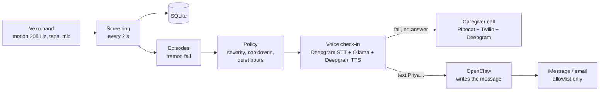

# Steady

**An always-on Parkinson's symptom monitor on a Vexo Open wristband that talks to you, and calls for help when you can't.**

Steady screens the wrist every 2 seconds for tremor and falls. When it finds something, it checks in by voice through your headphones. If a fall gets no answer, it phones your caregiver. It tracks and reports symptoms; it never diagnoses or advises on medication.

## What it does

1. **Screens all day.** The band streams motion at 208 Hz. Every 2 s Steady computes features, decides what the arm is doing (rest, active, walking, not worn), and runs detectors for **rest tremor**, **action tremor** and **falls**. Every assessment is logged to a local SQLite database.
2. **Checks in by voice.** A moderate tremor lasting 60 s, or any possible fall, opens a spoken conversation: the band's microphone goes to Deepgram, an Ollama model with tools answers, and Deepgram's voice speaks in the headphones. You can interrupt it, and a tap on the band means "yes, I'm OK".
3. **Holds back when it should.** Cooldowns, at most 3 check-ins an hour, quiet hours at night, nothing while the band is off the wrist. A fall interrupts any other conversation.
4. **Calls the caregiver.** If a fall gets no answer, or you say you need help, Steady phones your caregiver (then a backup) using **Pipecat + Twilio + Deepgram**. They press 1 or say yes to confirm they're on their way.
5. **Sends messages for you.** Say "text Priya I'm running late" and **OpenClaw** writes it; Steady sends it by iMessage or email after your yes. A daily brief goes to your caregiver at 20:00.

## Built with

| | How Steady uses it |
|---|---|
| **Vexo Open band** | Band 03 over USB-C or Bluetooth: 208 Hz accelerometer and gyroscope, tap and free-fall events, step activity, the microphone (Opus), and the LED as status light. The firmware is untouched; all analysis runs on the Mac. |
| **Deepgram** | **Nova-3** live speech-to-text on the band's Opus audio (interim results, `SpeechStarted` for barge-in, `UtteranceEnd`), and **Aura-2** streaming text-to-speech, sentence by sentence, in the headphones. On the phone call, the same models at 8 kHz through Pipecat. |
| **Pipecat** | The caregiver phone call is a Pipecat 1.16 pipeline: Twilio media stream, press-1 keypad, Deepgram STT, Silero VAD, Ollama with tools (`confirm_checking`, `get_latest_status`, `end_call`), Deepgram TTS. |
| **OpenClaw** | Writes the wording of spoken requests and the daily brief. Locked to a `steady` skill and a `steadyctl` CLI: it never sees a phone number or an address, and Steady delivers only to an allowlist. |
| **Ollama Cloud** | The voice agent's model (fast, tool-calling) for check-ins and calls. |
| **Twilio** | The phone line for the caregiver call, reached through a `cloudflared` tunnel that exposes only the call server. |

## How it fits together



## Detection

- **Rest tremor:** a 3.5 to 7.5 Hz rhythm in the gyroscope while the arm is at rest, strong enough and concentrated in one peak. An episode starts after 3 of 5 positive windows (about 10 s).
- **Action tremor:** a faster 7.5 to 12 Hz postural rhythm, or a 4 to 12 Hz rhythm that dominates a movement.
- **Fall:** free-fall, a hard impact, then stillness for 10 s.

**Validated** by playing 19 labelled wrist conditions into the pretend band through the full pipeline:

| Result | |
|---|---|
| Symptom phases detected | 7 of 7 |
| Look-alikes left alone (typing, walking, brushing teeth, vibration...) | 10 of 10 |
| Look-alike assessments wrongly flagged | 0 of 90 |

Known limits: a tremor while walking is missed, and a gentle voluntary 5 Hz rhythm can be flagged.

## Run it

Needs Python 3.11+, macOS, the band, and headphones.

```bash
git clone https://github.com/akshaylakkur/vexo && cd vexo
git clone https://github.com/VexoAI-Org/vexo-open-kit.git
python3 -m venv .venv && .venv/bin/pip install -r requirements.txt
brew install cloudflared                                   # caregiver calls
cp config/contacts.example.yaml config/contacts.yaml       # who may be contacted
```

`.env` (never committed): `DEEPGRAM_API_KEY`, `OLLAMA_API_KEY`, `TWILIO_ACCOUNT_SID`, `TWILIO_AUTH_TOKEN`, `TWILIO_FROM_NUMBER`, plus `OPENCLAW_HOOK_TOKEN` and `STEADY_API_TOKEN` for OpenClaw (see `openclaw/README.md`).

```bash
export PYTHONPATH=src
python -m steady doctor                      # checks keys, models, band, Twilio, tunnel, contacts
python -m steady run                         # the always-on service on band 03
python -m steady run --sim                   # same, on a pretend band
python -m steady talk --episode rest_tremor  # one check-in conversation now
python -m steady call --to caregiver         # a test call to the caregiver
python -m steady validate                    # the labelled detector validation
```

## Safety and privacy

- **Not a diagnosis.** Steady tracks and reports; it never says what a symptom means or suggests changing medication.
- **Local first.** All sensor data stays in SQLite on the Mac. Only speech goes to Deepgram, and the wearer is told so in the first conversation of the day.
- **Allowlist.** Only numbers and addresses in `config/contacts.yaml` can be contacted; models only see names.
- **Narrow exposure.** Only the call server is public, through the tunnel, with a one-time token per call. The pretend band never phones anyone.

## Project layout

```
src/steady/
  band/        connection, reconnects, ring buffer
  screening/   features, context, detectors, episodes, rollups
  policy/      when a finding becomes a check-in
  voice/       Deepgram STT and TTS, the conversation state machine
  agent/       the Ollama voice agent and its tools
  call/        the caregiver phone call (Pipecat + Twilio)
  actions/     OpenClaw tasks, iMessage and email delivery, daily brief
  validate/    the labelled validation protocol
tests/         87 tests (no network needed)
SPEC.md        the full design
```
